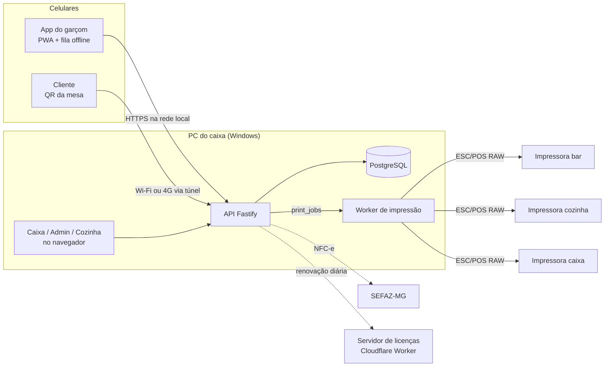

# ComandaSoft

**Sistema de comandas, pedidos, impressão e caixa para bares e restaurantes, em uso diário num restaurante real.**


O garçom lança o pedido no celular, cada item sai na impressora certa (bar, cozinha), o cliente acompanha a conta pelo QR Code da mesa, e o caixa fecha a conta com pagamento dividido, troco e cupom. Tudo roda num PC com Windows dentro do restaurante e **continua funcionando quando a internet cai**.

<!--
Capturas de tela: salve as imagens em docs/img/ com estes nomes e apague esta linha e a de baixo.

| Mapa de mesas (garçom) | Lançamento de pedido | Caixa |
|---|---|---|
|  |  |  |

| Cozinha (KDS) | Cardápio do cliente (QR) | Fila de impressão |
|---|---|---|
|  |  |  |
-->

---

## Sumário

- [O problema](#o-problema)
- [Em produção](#em-produção)
- [Funcionalidades](#funcionalidades)
- [Arquitetura](#arquitetura)
- [Decisões técnicas que valem destacar](#decisões-técnicas-que-valem-destacar)
- [Stack](#stack)
- [Qualidade e testes](#qualidade-e-testes)
- [Como rodar](#como-rodar)
- [Estrutura do repositório](#estrutura-do-repositório)
- [Documentação](#documentação)
- [Próximos passos](#próximos-passos)
- [Autor](#autor)

---

## O problema

Num restaurante cheio, a comanda de papel e os sistemas genéricos falham nos mesmos pontos:

- o **Wi-Fi oscila** e o pedido do garçom se perde (ou é lançado duas vezes);
- o pedido da cozinha e o do bar precisam sair **em impressoras diferentes**;
- a mesa quer **dividir a conta**: um paga a cerveja, outro paga um terço da porção, o resto vai no Pix;
- o caixa precisa fechar o dia sabendo **quanto sobrou ou faltou**, e quem deu cada desconto.

O ComandaSoft foi desenhado a partir dessas situações, com o dono do restaurante validando cada decisão.

## Em produção

- Instalado no **PC do caixa de um restaurante** (Windows), usado no dia a dia por garçons, caixa e cozinha.
- Os garçons usam o sistema como **app instalado no celular** (Android e iPhone).
- Imprime em **impressoras térmicas Elgin** de rede, roteando por categoria.
- Atualizações são entregues por um **instalador próprio** (`ATUALIZAR.bat`), que faz backup antes de trocar a versão.
- Versão atual: **0.15.x**. O histórico de commits mostra a evolução por fases, incluindo os ajustes pedidos depois do primeiro dia de uso na loja.

## Funcionalidades

**Garçom (PWA no celular)**
- Mapa de mesas com cores por situação (livre, ocupada, conta impressa, pago parcial).
- Abertura de comanda por nome + mesa, lançamento de pedidos com fotos, observações e "para viagem".
- **Fila offline**: sem rede, o pedido fica guardado no aparelho e é enviado ao reconectar, sem duplicar.
- "Minhas mesas", pedido de fechamento e pré-conta.

**Cozinha**
- Painel de produção (KDS) com atalhos de teclado, entrega parcial e resumo do que está pendente.

**Caixa**
- Abertura e fechamento com conferência de diferença, sangria e suprimento.
- Busca da conta por mesa ou CPF.
- Pagamento **por valor, dividido por N ou por item/fração** (ex.: 1/3 da pizza), em crédito, débito, Pix ou dinheiro com troco.
- Desconto, estorno e cancelamento com **PIN de gerente** e registro em auditoria.
- Contas fechadas com o cupom exibido na tela, igual ao papel.

**Cliente (QR Code da mesa)**
- Cardápio com destaques e selos; acompanhamento da própria comanda com um PIN.
- Funciona no Wi-Fi da loja e também pelo 4G do cliente (túnel da Cloudflare).

**Administração**
- Cadastro de categorias, produtos, mesas, usuários e impressoras (lidas do Windows).
- Fila de impressão com prévia exata do papel, erros por impressora e reimpressão.
- Relatórios de vendas e por garçom, trilha de auditoria.
- Licenciamento por cliente para venda a outros estabelecimentos.
- **NFC-e** direto com a SEFAZ-MG (assinatura XML e comunicação implementadas, em fase de homologação).

## Arquitetura



O servidor roda **dentro do restaurante**: se a internet cair, garçons, caixa e impressoras continuam se falando pela rede local. Só a NFC-e e o QR pelo 4G dependem de internet.

## Decisões técnicas que valem destacar

| Problema | Solução |
|---|---|
| Pedido não pode se perder nem duplicar com Wi-Fi instável | Fila local em IndexedDB (Dexie) no celular. Cada escrita leva um `client_uuid`, e o servidor trata o reenvio como **idempotente**. |
| Pedido gravado mas cupom não impresso (ou o contrário) | Pedido e `print_jobs` são gravados **na mesma transação**. Um worker consome a fila, mantém a ordem por impressora e tenta de novo com backoff (5 s, 10 s, 20 s… até 1 min). |
| Erro de arredondamento em conta dividida | **Dinheiro sempre em centavos (inteiro)**, nunca float. Rateio por fração de item com distribuição exata dos centavos. |
| Contrato da API divergir entre front e back | Schemas **Zod** em `packages/shared`, importados pelos dois lados. |
| CPF do cliente é dado sensível (LGPD) | Nunca gravado em claro: **HMAC** para busca, **AES-256-GCM** para o "CPF na nota", chaves derivadas com HKDF. Rate limit contra força bruta no QR. |
| Impressoras térmicas com acentuação própria | Pacote próprio `packages/escpos`: comandos ESC/POS, tabelas CP860/850/437 e prévia em texto para testar **sem impressora**. |
| PWA exige HTTPS, inclusive na rede local | Certificado mkcert com página de instalação para os celulares, ou domínio próprio com **Let's Encrypt** (ACME). |
| Ação sensível sem controle | Permissão checada **no servidor** por perfil (Admin, Gerente, Caixa, Garçom) e gravada em `audit_logs`. |
| Vender o sistema sem prender os dados do cliente | Licença assinada com **Ed25519** + lease curto renovado por um Cloudflare Worker. O bloqueio nunca interrompe um movimento em andamento. Desenho em [docs/licenciamento.md](docs/licenciamento.md). |
| Instalar num PC sem técnico por perto | Instalador PowerShell que instala dependências via `winget`, gera segredos, certificado, firewall, serviço automático, backup diário e um vigia que reinicia o servidor se travar. |

## Stack

| Camada | Tecnologias |
|---|---|
| Linguagem | TypeScript (modo estrito) em todo o projeto |
| Monorepo | pnpm workspaces |
| Back-end | Node.js 22, Fastify 5, Drizzle ORM, PostgreSQL 16, Zod, JWT (jose), argon2 |
| Front-end | React 19, Vite 7, Tailwind CSS 4, TanStack Query, React Router 7 |
| Offline / PWA | vite-plugin-pwa (Workbox), Dexie (IndexedDB) |
| Impressão | ESC/POS em modo RAW pelo spooler do Windows |
| Fiscal | XML da NFC-e assinado (node-forge + node:crypto), certificado A1 |
| Infra | Windows (tarefa agendada + PowerShell), Cloudflare Workers/KV e Tunnel, Let's Encrypt |
| Testes | Vitest, PGlite (Postgres em memória), fake-indexeddb |

## Qualidade e testes

- **29 arquivos de teste e mais de 270 casos** cobrindo autenticação, caixa, pagamentos parciais, cancelamentos, transferências, impressão, cozinha, QR do cliente, licenciamento e NFC-e.
- A API é testada contra um **PostgreSQL real em memória (PGlite)**: os testes não precisam de banco instalado.
- A fila offline do celular é testada com IndexedDB simulado.
- A impressão usa um transporte falso nos testes, para conferir o conteúdo exato de cada cupom.
- Migrations versionadas com drizzle-kit em `apps/server/drizzle/`.

```bash
pnpm test        # todos os testes
pnpm typecheck   # checagem de tipos em todos os pacotes
```

## Como rodar

### Demonstração rápida (sem instalar PostgreSQL)

O modo sandbox sobe a API com banco em memória e um cardápio de exemplo:

```bash
pnpm install
SANDBOX_PASSWORD=demo12345 SANDBOX_DEMO=1 PORT=3100 pnpm --filter @sistema-bar/server sandbox
```

Em outro terminal:

```bash
cd apps/web && PORT=3100 npx vite --port 5175
```

Abra http://localhost:5175 e entre com o usuário `teste` e a senha definida em `SANDBOX_PASSWORD` (mínimo 8 caracteres).

> No PowerShell, defina as variáveis antes com `$env:SANDBOX_PASSWORD="demo12345"` e assim por diante.

### Ambiente completo

Requer Node.js 22+, pnpm 10 e PostgreSQL 16. O passo a passo (banco, `.env`, HTTPS para testar no celular, impressoras e instalação no PC do restaurante) está em **[docs/desenvolvimento.md](docs/desenvolvimento.md)**.

```bash
pnpm install
cp .env.example .env   # ajuste DATABASE_URL, JWT_SECRET e CPF_SECRET
pnpm db:seed           # cria as tabelas e o usuário admin
pnpm dev               # API em :3000 e PWA em :5173
```

## Estrutura do repositório

```
apps/
  server/            API Fastify: rotas por perfil, workers de impressão e fiscal, licenciamento
    src/routes/      admin, caixa, garçom, cozinha, público (QR)
    src/printing/    layouts dos cupons, fila e envio às impressoras
    src/fiscal/      NFC-e: montagem, assinatura, chave, QR Code e comunicação com a SEFAZ
    test/            testes de integração da API (PGlite)
  web/               PWA React: telas do garçom, caixa, cozinha, admin e cliente
    src/lib/offline/ fila offline (outbox) e cache com Dexie
packages/
  shared/            schemas Zod, dinheiro, CPF, regras de cobrança e datas
  escpos/            gerador ESC/POS, acentuação e prévia em texto
instalador/          scripts de instalação, atualização, backup e manutenção no Windows
servidor-licencas/   Cloudflare Worker que renova as licenças
docs/                guias de desenvolvimento, licenciamento e roteiro de testes
SPEC.md              especificação do produto e decisões tomadas com o dono
```

## Documentação

| Documento | Conteúdo |
|---|---|
| [SPEC.md](SPEC.md) | Especificação completa: requisitos, modelo de dados, permissões, roadmap e decisões |
| [docs/desenvolvimento.md](docs/desenvolvimento.md) | Instalação do ambiente, impressoras, celular, instalador e problemas comuns |
| [docs/licenciamento.md](docs/licenciamento.md) | Desenho do sistema de licenças |
| [docs/roteiro-teste-bar.md](docs/roteiro-teste-bar.md) | Roteiro de testes na loja antes de liberar uma versão |

## Próximos passos

- NFC-e em produção (hoje em homologação com a SEFAZ-MG).
- Testes end-to-end com Playwright.
- Controle de estoque e ficha técnica.

## Autor

**Paulo Faria**

- GitHub: [@paulohjunior3-debug](https://github.com/paulohjunior3-debug)
- LinkedIn: _adicione o link aqui_
- E-mail: _adicione aqui_
